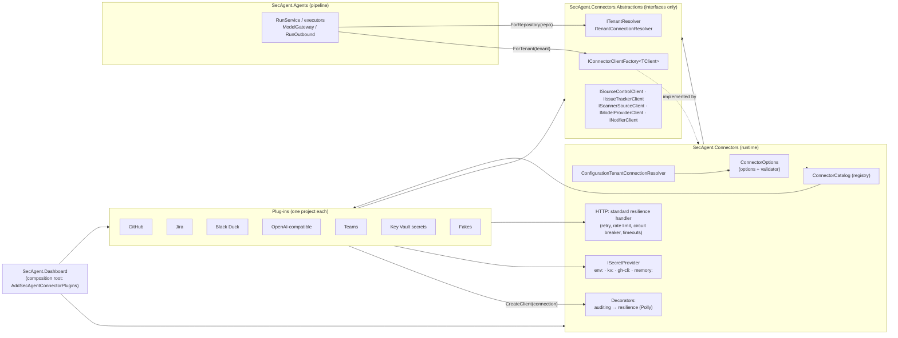

# Connectors

The agent talks to outside systems (GitHub, Jira, Black Duck, the model provider, Microsoft Teams) only through **connectors**.
A connector is a small plug-in behind an interface. The pipeline asks for "the source control client of this tenant" and never knows
whether it gets GitHub, a fake in-memory GitHub, or (later) Azure DevOps. Which plug-in serves which tenant is **configuration**.

Design reference: System Design Doc v0.3, sections 9.7 (Connections) and 9.8 (`IConnector`).

## The five kinds

| Kind | Interface (client) | Real plug-in | What the agent may do | What it can never do |
|---|---|---|---|---|
| Source control | `ISourceControlClient` | `github` (REST + local `git push`) | read PR and changed files, create branch, commit, push its own branch, open PR, comment, read check runs | **merge**, approve, change branch protection, force push |
| Issue tracker (optional) | `IIssueTrackerClient` | `jira` (REST v3 / v2) | create and update issues, transition, link a PR, comment | delete, administer projects or workflows |
| Scanner source (optional) | `IScannerSourceClient` | `blackduck` (REST, read-only) | find a project version, list its vulnerabilities (backlog mode), read upgrade guidance | change policy, ignore components, write remediation status |
| Model provider | `IModelProviderClient` | `openai-compatible` (Ollama, OpenAI, Azure OpenAI v1) | chat completion with JSON-schema structured output, token usage, list models | anything else |
| Notifier (optional) | `INotifierClient` | `teams` (Workflows webhook card) | post a card | read messages |

Every kind also has a `fake` plug-in (in-memory, deterministic, records every call). It is how the tests run the whole pipeline without
any real system.

Each client is a union of **small interfaces**, so code asks only for what it uses. For example `ISourceControlClient` =
`IPullRequestReader` + `IPullRequestWriter` + `IPullRequestCommenter` + `IBranchWriter` + `ICommitWriter` + `ICheckRunReader` +
`IBranchPublisher` + `IRepositoryLocator`. There is **no merge method anywhere**: you cannot call what does not exist. A reflection test
checks every connector interface and type for merge/approve-like members, and the GitHub HTTP client also has a `NoMergeGuardHandler`
that refuses any request to a merge, review-approve or branch-protection endpoint, as a second line of defence.

## How a call flows



In words, for one call:

1. The pipeline asks `ITenantResolver.ForRepository("org/repo")` which tenant owns the repository (once per run; stored on the run).
2. It asks `IConnectorClientFactory<ISourceControlClient>.ForTenant(tenant)` for a client.
3. The runtime looks up the tenant's connection in configuration (`ITenantConnectionResolver`): provider id, base URL, secret
   **reference**, settings. Then it finds the plug-in with that id in the catalogue and lets it build the client.
4. The client is wrapped in decorators: an **auditing** decorator (who, which tenant, which operation, how long, outcome; never secret
   values or payloads) and a **resilience** decorator (retry with backoff for idempotent calls only, a per-tenant circuit breaker, timeouts).
   HTTP plug-ins also get `Microsoft.Extensions.Http.Resilience` on their `HttpClient` (retries on GET only, rate limiting, circuit breaker).
5. The plug-in asks `ISecretProvider` for the secret only when it makes the call. The pipeline never sees a token.

Optional kinds (issue tracker, notifier, scanner source) use `TryForTenant`: if a tenant has none, the step is skipped. A failing issue
tracker or notifier never fails a run; the run feed shows a warning instead.

## Where things live

| Project | Holds | Depends on |
|---|---|---|
| `SecAgent.Connectors.Abstractions` | client interfaces, request/response records, `IConnector`, descriptors, errors, tenant and secret interfaces | nothing |
| `SecAgent.Connectors` | options + validation, tenant resolution, secret sources (`env:`), catalogue, client factory, decorators, audit sinks, REST client base, health service | Abstractions, Polly, Microsoft.Extensions.* |
| `SecAgent.Connectors.GitHub` / `.Jira` / `.BlackDuck` / `.OpenAI` / `.Teams` / `.KeyVault` | one plug-in each | Abstractions + runtime only |
| `SecAgent.Connectors.Fakes` | in-memory fakes for all five kinds, `FakeConnectorWorld` with recorded interactions, `memory:` secrets | Abstractions + runtime only |
| `SecAgent.Agents` | the pipeline; uses `PipelineConnectors` (tenant resolver + one client factory per kind) | **Abstractions only** (architecture test) |
| `SecAgent.Dashboard` | composition root: `AddSecAgentConnectorPlugins` registers the runtime and every plug-in | everything |

Architecture tests enforce this: the pipeline references no connector implementation, the abstractions reference nothing, plug-ins do not
reference each other, and only the dashboard references implementations.

## Configuration

All of it is in the `Connectors` section of `src/SecAgent.Dashboard/appsettings.json` (override in `appsettings.Local.json` or with
environment variables such as `Connectors__Tenants__local__IssueTracker__Provider=jira`). Configuration holds **provider ids, URLs and secret
references only**. The validator rejects a secret-looking value in a setting, an unknown provider id, a missing required field, a
repository that would belong to two tenants, and (multi-tenant) a process-wide secret scheme such as `env:` (only tenant-scoped
stores such as `kv:` are allowed), as well as a shared `Defaults` connection for anything except the model provider.

Secret references:

| Reference | Resolves to | Use |
|---|---|---|
| `env:NAME` | environment variable `NAME` | local, single-tenant |
| `kv:name` | secret `name` in `Connectors:KeyVault:DefaultVaultUri` (managed identity, "Key Vault Secrets User") | customer-hosted Azure |
| `kv:https://<vault>.vault.azure.net/secrets/<name>` | that secret in that vault | multi-tenant: one vault per tenant |
| `gh-cli:token` | `gh auth token` of the signed-in GitHub CLI | laptop only |
| `memory:name` | value set by a test | tests only |

`Defaults` applies to every tenant that does not set that kind itself. If nothing configures a model provider, the existing
`ModelProvider` switch (`ollama` / `openai` / `azureopenai`) becomes the default model connection, so that switch keeps working unchanged.
In multi-tenant mode set `Defaults.ModelProvider` explicitly with a `kv:` key: the switch's key is an `env:` reference, which the validator
rejects there.

### Single-tenant, customer-hosted

One constant tenant. Every repository belongs to it.

```json
{
  "Connectors": {
    "DeploymentModel": "SingleTenant",
    "DefaultTenant": "contoso",
    "KeyVault": { "DefaultVaultUri": "https://kv-secagent-contoso.vault.azure.net/" },
    "Tenants": {
      "contoso": {
        "SourceControl": { "Provider": "github", "BaseUrl": "https://api.github.com/", "Secret": "kv:github-token" },
        "IssueTracker": {
          "Provider": "jira",
          "BaseUrl": "https://contoso-example.atlassian.net",
          "Secret": "kv:jira-api-token",
          "Settings": { "AuthMode": "basic", "Email": "secagent-bot@example.invalid", "ProjectKey": "SEC" }
        },
        "ScannerSource": { "Provider": "blackduck", "BaseUrl": "https://blackduck.example.invalid", "Secret": "kv:blackduck-api-token" },
        "ModelProvider": {
          "Provider": "openai-compatible",
          "BaseUrl": "https://contoso-example.openai.azure.com/openai/v1/",
          "Secret": "kv:azure-openai-key",
          "Settings": { "Flavor": "azureopenai" }
        },
        "Notifier": { "Provider": "teams", "Secret": "kv:teams-webhook-url" }
      }
    }
  }
}
```

### Multi-tenant, Wipro-hosted

One entry per customer. `Repositories` decides which tenant a run belongs to (exact `org/repo` or `org/*`). A repository that matches no
tenant is refused; it never falls back to another tenant's connection. Each tenant has its own vault, so one tenant's identity cannot read
another's secrets. The shared model deployment sits in `Defaults`.

```json
{
  "Connectors": {
    "DeploymentModel": "MultiTenant",
    "Defaults": {
      "ModelProvider": {
        "Provider": "openai-compatible",
        "BaseUrl": "https://wipro-secagent-example.openai.azure.com/openai/v1/",
        "Secret": "kv:https://kv-secagent-shared.vault.azure.net/secrets/azure-openai-key",
        "Settings": { "Flavor": "azureopenai" }
      }
    },
    "Tenants": {
      "tenant-a": {
        "Repositories": [ "tenant-a-org/*" ],
        "SourceControl": { "Provider": "github", "Secret": "kv:https://kv-secagent-tenant-a.vault.azure.net/secrets/github-token" },
        "IssueTracker": {
          "Provider": "jira",
          "BaseUrl": "https://tenant-a-example.atlassian.net",
          "Secret": "kv:https://kv-secagent-tenant-a.vault.azure.net/secrets/jira-api-token",
          "Settings": { "Email": "secagent-bot@example.invalid", "ProjectKey": "APPSEC" }
        },
        "Notifier": { "Provider": "teams", "Secret": "kv:https://kv-secagent-tenant-a.vault.azure.net/secrets/teams-webhook-url" }
      },
      "tenant-b": {
        "Repositories": [ "tenant-b-org/payments-api", "tenant-b-org/web-portal" ],
        "SourceControl": { "Provider": "github", "Secret": "kv:https://kv-secagent-tenant-b.vault.azure.net/secrets/github-token" },
        "ScannerSource": {
          "Provider": "blackduck",
          "BaseUrl": "https://blackduck.tenant-b.example.invalid",
          "Secret": "kv:https://kv-secagent-tenant-b.vault.azure.net/secrets/blackduck-api-token"
        },
        "IssueTracker": { "Provider": "none" }
      }
    }
  }
}
```

Both examples are loaded and validated by a test (`ConnectorCompositionTests`), so they stay correct.

### Running everything against fakes

Set every kind to `fake` (for a demo or a test). Nothing leaves the process; the Connections page shows them as "simulated".

```json
{
  "Connectors": {
    "DeploymentModel": "SingleTenant",
    "DefaultTenant": "demo",
    "Tenants": {
      "demo": {
        "SourceControl": { "Provider": "fake" },
        "IssueTracker": { "Provider": "fake", "Settings": { "ProjectKey": "DEMO" } },
        "ScannerSource": { "Provider": "fake" },
        "ModelProvider": { "Provider": "fake" },
        "Notifier": { "Provider": "fake" }
      }
    }
  }
}
```

### Resilience settings

`Connectors:Resilience` (defaults in brackets): `MaxRetryAttempts` (3), `BaseDelay` (500 ms, exponential, jitter), `AttemptTimeout`
(30 s), `ModelAttemptTimeout` (10 min, because local models are slow), `TotalTimeout` (120 s), `PermitsPerSecond` (10) and `QueueLimit` (50) for
rate limiting, plus `CircuitBreakerFailureRatio` (0.5), `CircuitBreakerMinimumThroughput` (5), `CircuitBreakerSamplingDuration` (30 s) and
`CircuitBreakerBreakDuration` (30 s). Circuits are kept **per tenant and per connector**, so one customer's broken Jira does not stop another's.

## Connections page API

* `GET /api/connectors?tenant=<id>`: the deployment model, the tenants, the catalogue (one **capability descriptor** per plug-in: kind,
  capabilities, scopes requested with the reason, the things it is never granted, setup fields, and whether it is simulated) and the
  tenant's configured connections. Secrets are shown as references only.
* `GET /api/connectors/health?tenant=<id>`: runs each configured connector's health check (one cheap read call, or an in-memory check for fakes).

## How to add a connector

Example: an Azure DevOps source control connector.

1. **Create a project** `src/SecAgent.Connectors.AzureDevOps` that references only `SecAgent.Connectors.Abstractions` and
   `SecAgent.Connectors`. Add it to `SecAgent.slnx` and reference it from `SecAgent.Dashboard`.
2. **Write the client**: a class that implements the kind's client interface (`ISourceControlClient`). For a REST API, derive from
   `ConnectorRestClient` (it handles base URL, JSON, error mapping to `ConnectorException`, and refuses links to other hosts) and fetch the
   secret through the injected `ISecretProvider` when you call. Do not add capabilities the interface does not have.
3. **Write the plug-in**: a class that implements `IConnectorClientProvider<ISourceControlClient>`:
   * `Describe()` returns a `ConnectorDescriptor`: id (`"azure-devops"`), display name, capabilities, scopes with reasons, never-granted
     list, setup fields (secret fields are references), and notes (say **ASSUMPTION** for anything not verified against a live system).
   * `CreateClient(connection)` builds the client for one tenant's connection (use a named `HttpClient` from `IHttpClientFactory`).
   * `CheckHealthAsync(connection)` makes one cheap read call and returns `Failing` instead of throwing.
4. **Register it** with an extension method:
   ```csharp
   public static ConnectorsBuilder AddAzureDevOpsConnector(this ConnectorsBuilder b)
   {
       b.Services.AddConnectorHttpClient(AzureDevOpsConnector.Id);   // named HttpClient + standard resilience handler
       return b.AddConnector<AzureDevOpsConnector, ISourceControlClient>();
   }
   ```
   and add `.AddAzureDevOpsConnector()` in `DashboardComposition.AddSecAgentConnectorPlugins`. Nothing else in the host or the pipeline
   changes; the decorators, tenant resolution, validation and Connections page pick it up.
5. **Test it**: derive a class from the kind's contract test base (`SourceControlContract`, `IssueTrackerContract`, `ScannerSourceContract`
   in `tests/SecAgent.Tests/Connectors`) and back it with an `HttpMessageHandler` stub or simulator. The same tests then run against the fake
   and your connector. Never call a real system from a test.
6. **Configure it**: `"SourceControl": { "Provider": "azure-devops", "BaseUrl": "...", "Secret": "kv:..." }` for the tenants that use it.

A new **kind** (rare) also needs an interface in the abstractions, a client decorator in `SecAgent.Connectors/Decorators`, an entry in
`ConnectorKind` / `ConnectorKinds`, a property on `TenantConnectionsOptions` and a fake.

## Testing

* **Fakes** (`SecAgent.Connectors.Fakes`): a shared `FakeConnectorWorld` holds repositories, PRs, issues, scanner projects, scripted model
  replies and notifications, and records every call (`world.Interactions`) so tests can assert exactly what the agent did.
* **Contract tests**: one abstract test class per kind, run against the fake and the real plug-in (the real one against an in-process HTTP
  simulator of GitHub / Jira / Black Duck). If the fake and the real client disagree, a test fails.
* **Pipeline on fakes**: `PipelineEndToEndOnFakesTests` runs a full run (PR read → scan → triage with a scripted model → fix → verify →
  fix PR → Jira-style ticket → Teams-style card) with every connector faked.
* **Runtime tests**: options validation, tenant isolation, secrets, audit records, retry only for idempotent calls, per-tenant circuits,
  the no-merge guard, catalogue and health.

## Known gaps (ASSUMPTIONs and open items)

* Jira, Black Duck and Teams request/response shapes are built from public documentation and checked against simulators only (marked
  ASSUMPTION in code and descriptors). Verify against a live sandbox before production.
* GitHub App installation tokens (JWT exchange) are not implemented yet: the GitHub plug-in takes a token reference. `git push` still uses
  the machine's git credential helper.
* Azure OpenAI with managed identity (no key) is not implemented; the key comes from a secret reference.
* The Connections page connect/revoke flow (SDD 9.7) is not built; connections come from configuration.
* Audit events go to the log and an in-memory ring buffer; a SQL / Log Analytics sink is still to do.
