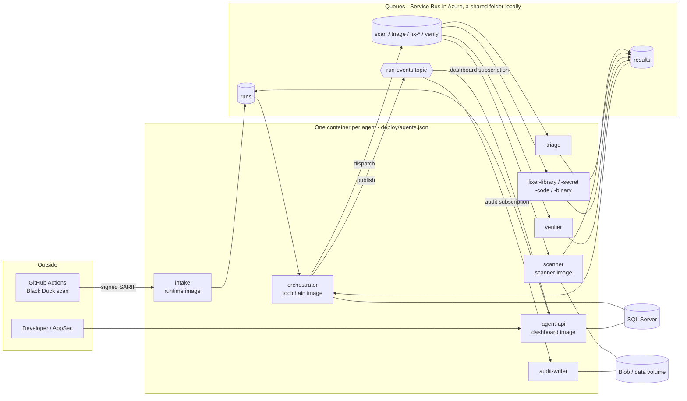
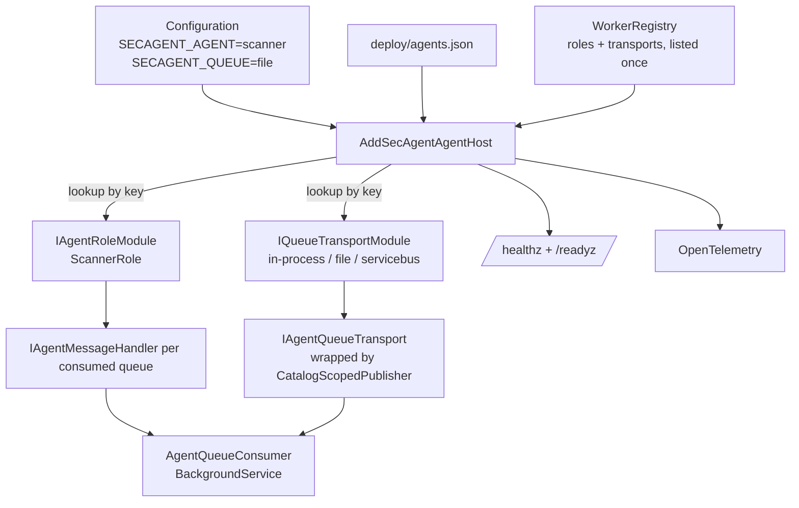
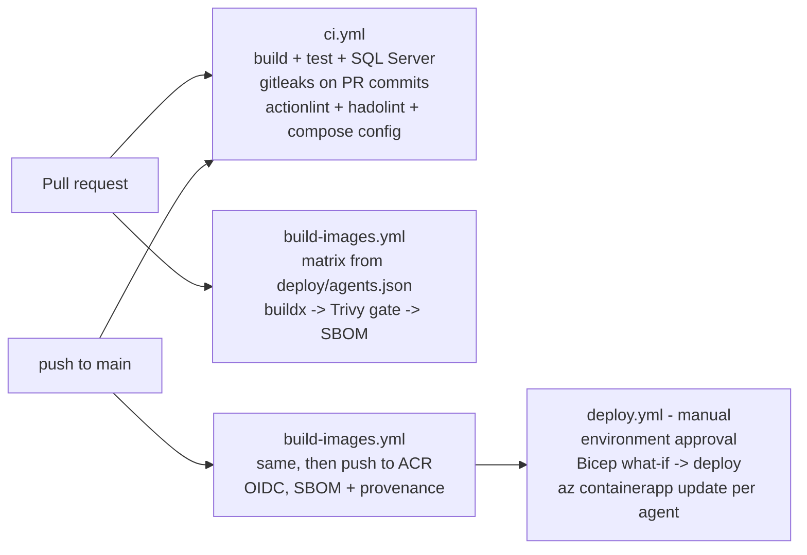

# Containers and CI/CD

This page explains how each agent runs in its own container, how to run all of them on one machine, and how CI/CD builds, checks and
deploys them. Everything here uses synthetic data only. Nothing has been deployed to Azure.

## In one paragraph

Before this change, the whole pipeline ran in one process: `secagent serve` (the dashboard) or `secagent run`. That still works and is
still the normal developer mode. This change adds a second way to run the same code: **one container per agent**. Every agent, except the
dashboard / agent-api, uses one small host program, `secagent-worker`. You tell it which agent to be with one setting, `SECAGENT_AGENT`
(for example `scanner`), and how to reach the queues with another, `SECAGENT_QUEUE` (`file` locally, `servicebus` in Azure). The list of
agents, the queues each one reads, and the queues each one may send to are written once, in **`deploy/agents.json`**. The worker,
docker-compose, the image build and the deploy workflow all read that file. It mirrors `infra/agents.bicep` from PR #3, and a test checks
that the two agree.

## The picture



## How a worker picks its role (and why there is no `if role == ...`)



1. `AgentCatalog` loads `deploy/agents.json` and checks it: unique names, valid queue names, and every queue someone sends to has a reader.
2. `AgentHostRegistry` finds the **transport module** and the **role module** by name, using a dictionary lookup. An unknown name stops
   the host with one clear line that lists the valid names (exit code 2, no stack trace).
3. The role module registers only what that agent needs. For example, `ScannerRole` registers the scanner adapters, the git fetcher and
   one handler for the `scan` queue. It does not register SQL, because the scanner has no database access in Azure either.
4. `AddAgentMessageHandler` refuses to bind a handler to a queue that the catalogue entry does not list. Sends go through
   `CatalogScopedPublisher`, which refuses queues the agent is not allowed to send to. This mirrors the Service Bus RBAC in PR #3, so a
   wiring mistake shows up in a local test and not as a 403 in Azure.
5. `AgentQueueConsumer` (a hosted service) receives each message, opens a DI scope and a trace span, runs the handler, and then
   completes, retries or dead-letters the message. A malformed message is dead-lettered straight away and is not retried.

Adding an agent takes one entry in `deploy/agents.json` (and in `infra/agents.bicep`), one `IAgentRoleModule` class, and one line in
`WorkerRegistry`. Existing code does not change.

## What each container image contains

One `deploy/Dockerfile` builds four image targets. Each agent's image is built from one of them, with `AGENT_ROLE` baked in as the
default role.

| Target | Base | Used by | Why |
|---|---|---|---|
| `runtime` | `aspnet:10.0-noble-chiseled-extra` (no shell, no package manager) | intake, triage, audit-writer | smallest (~190 MB), nothing to exploit |
| `scanner` | `aspnet:10.0-noble` + git, gitleaks 8.30.1, Trivy 0.75.0, Semgrep 1.179.0 | scanner | the scanners need a normal Linux userland |
| `toolchain` | `sdk:10.0-noble` + the same tools + gh 2.102.0 | orchestrator, fixers, verifier | fixers run `dotnet`/`npm`-style builds and re-scan |
| `dashboard` | same as toolchain | agent-api | `secagent serve` |

Rules every image follows:

- Multi-stage build. Restore is cached on the project files; the restored packages are kept in that layer (not in a BuildKit cache
  mount, which is empty on a fresh CI runner even when the layer comes from the GHA cache). Only the NuGet HTTP cache is a cache
  mount. Release binaries only.
- Base images are pinned by digest. Tool binaries are pinned by version **and** sha256 (amd64 and arm64). There are no `curl | sh` install
  scripts and no `latest` tags.
- gitleaks is built from its pinned, checksummed v8.30.1 source with Go 1.26.8 and current `golang.org/x/crypto` / `x/text`. The
  official v8.30.1 binary (the latest release) is built with Go 1.24.11, and the CI image gate failed on 33 fixable HIGH/CRITICAL CVEs
  in it. The rebuilt binary scans clean. Switch back to the release binary once upstream ships one built with a current Go.
- Runs as non-root user `app` (UID 1654). Works with a read-only root file system: writable paths are only `/tmp` (tmpfs) and `/data`.
- `HEALTHCHECK` uses `secagent-worker probe`, because the chiselled image has no curl.
- `.dockerignore` is an allow-list: only `src/`, `rules/`, `db/`, `deploy/agents.json` and the build files go into the build context. It
  never includes `.data/`, `.env` or tests.

## Run it locally

### Option 1: one process (unchanged)

```bash
dotnet build SecAgent.slnx
dotnet src/SecAgent.Dashboard/bin/Debug/net10.0/secagent.dll serve --port 8795
```

### Option 2: one container per agent

You need Docker with Compose v2.

```bash
cp deploy/compose.env.example .env     # git-ignored
# edit .env: MSSQL_SA_PASSWORD (your own), SECAGENT_HMAC_KEY (openssl rand -hex 32),
#            optional SECAGENT_INTAKE_HMAC_SECRET, SECAGENT_INTAKE_PORT / SECAGENT_DASHBOARD_PORT if 8080 / 8795 are taken
docker compose up --build -d
docker compose ps                      # every agent should become "healthy"
curl -s localhost:8080/readyz          # intake: {"status":"Healthy","checks":[role, transport, consumer]}
open http://localhost:8795             # dashboard (agent-api)
docker compose down                    # SIGTERM -> each agent drains in-flight work (up to 30 s), then exits 0
```

What compose starts: SQL Server 2022, a one-time `db-init` that creates the database, and the 11 agents. Each agent runs with
`read_only: true`, `cap_drop: [ALL]`, `no-new-privileges`, a tmpfs `/tmp`, and a shared `agent-data` volume mounted at `/data`.

- **Queues locally** use `FileSystemMessageQueue`, a folder per queue on the shared volume (`ready/`, `inflight/` claimed by an atomic
  rename, `dlq/`, plus a duplicate-detection window). It behaves like Service Bus in the ways that matter here: one consumer per message,
  lock expiry, max deliveries, then the dead-letter queue.
- **Why not the Service Bus emulator?** The emulator only supports SAS connection strings. This repo uses Entra ID only
  (`DefaultAzureCredential`, no keys), and adding a key-based path just for local runs would mean shipping code that never runs in Azure.
  The Service Bus transport (`src/SecAgent.Hosting.Azure`) has to be exercised against a real namespace (open item).
- **Scanner demo with a local repo.** Put synthetic git repos in `./.data/samples` (mounted read-only at `/samples`). A `ScanRequest`
  with `local_path` makes the scanner fetch from there instead of GitHub. Trivy's vulnerability DB (~1 GB) is cached under `/data/cache`.

### Configuration reference (worker)

| Setting (env var / config key) | Meaning |
|---|---|
| `SECAGENT_AGENT` / `Agent:Role` | which agent from `deploy/agents.json` to run |
| `SECAGENT_QUEUE` / `Agent:Transport` | `in-process` (tests), `file` (compose), `servicebus` (Azure) |
| `SECAGENT_SERVICEBUS_NAMESPACE` | `<ns>.servicebus.windows.net` (Entra ID auth, `AZURE_CLIENT_ID` = user-assigned identity) |
| `Agent__ServiceBus__SessionlessQueues__0..n` | queues created without sessions (mirror of the Bicep `sessionlessQueues` param) |
| `SECAGENT_SQL` | SQL connection string. Only for the agents that use SQL. |
| `SECAGENT_HMAC_KEY` | fingerprint/evidence hashing key. Must be the same in every agent. |
| `Agent__DrainTimeoutSeconds` | graceful-shutdown drain time (30). Keep the container stop timeout above it. |
| `Agent__LockRenewalSeconds` | how often the consumer renews the message / session lock (or the file-queue lease) while a handler runs (30; 0 = off). Keep it well below the queue's lock duration (Bicep: 5 min) and the file-queue lease (5 min). |
| `Agent__MaxConcurrentMessages`, `Agent__MaxDeliveries`, `Agent__ReceiveWaitSeconds` | consumer tuning |
| `OTEL_SERVICE_NAME`, `OTEL_EXPORTER_OTLP_ENDPOINT` | OpenTelemetry: traces, metrics and logs over OTLP when an endpoint is set. `SECAGENT_OTEL_CONSOLE=1` prints them. |

### Health, readiness, shutdown, telemetry

- `/healthz` is **liveness**: the process is up. It never checks dependencies, so a slow database does not cause restart loops.
- `/readyz` is **readiness**: the role is composed, the transport is reachable, and the consumer loop is running and not draining. It
  returns JSON with one entry per check. For Service Bus, "reachable" means a real broker round trip: the most recent receive must
  not have failed, and a probe opens a sender link on the first entity the role sends to and peeks the first subscription (or
  sessionless queue) it consumes. Neither sends nor consumes anything; session queues are never probed (accepting a session would
  take it). A wrong namespace, missing RBAC or a broker outage reports not ready. Results are cached (30 s after success, 5 s after a
  failure; 10 s timeout) so frequent probes do not load the broker.
- **Long handlers keep their lock.** While a handler runs, the consumer renews the delivery's lock every `Agent:LockRenewalSeconds`:
  the session lock on session queues, the message lock otherwise, and the claim's lease on the file queue. A lost lock is logged (the
  message may be redelivered; handlers are idempotent). A failed Complete / Abandon / DeadLetter is logged and never stops the
  receive loop; the broker redelivers the message when its lock expires.
- **File-queue claims are unique.** Each claim gets its own file name (`<message>~<claim id>.json`), so after a lease expires and
  another consumer re-claims the message, the first consumer's late Complete or Abandon cannot delete or duplicate the new claim.
- **Run events are retried.** The orchestrator retries a failed publish to `run-events` with backoff (1 s doubling to 30 s), in order,
  instead of dropping it. MessageId `run:seq` lets Service Bus duplicate detection drop a retry that already reached the broker. Events
  still queued at shutdown are logged as undelivered (see Open items: outbox).
- **Graceful shutdown:** on SIGTERM, readiness turns unhealthy, no new messages are taken, and in-flight messages get
  `Agent:DrainTimeoutSeconds` to finish. Anything still running after that is abandoned, so Service Bus (or the file queue) delivers it
  again. The host's shutdown timeout is the drain time plus 10 s, and compose's `stop_grace_period` is 40 s.
- **OpenTelemetry:** one consumer span per message (`messaging.destination.name`, `messaging.message.id`, `secagent.run_id`,
  `secagent.outcome`), plus the pipeline's own sources (SecAgent, GenAI, Agent Framework workflows). Meter `SecAgent.Agent` has `secagent.agent.messages` (counted by queue and
  outcome: completed, retried, dead-lettered) and `secagent.agent.message.duration`. Kestrel and ASP.NET Core metrics are collected
  too. The resource name is `OTEL_SERVICE_NAME` (`ca-<agent>-<env>` from the Bicep), else `secagent-<agent>`. In Azure, point the OTLP
  endpoint at the Container Apps managed OpenTelemetry agent, which forwards to Application Insights.

## CI/CD



| Workflow | When | What it does |
|---|---|---|
| `.github/workflows/ci.yml` | every PR, push to main | `dotnet build -warnaserror` and the non-golden tests, against a throwaway SQL Server container whose password is generated per run and masked. gitleaks scans the PR's own commits (or the full history on main). actionlint, hadolint, a catalogue sanity check and `docker compose config`. |
| `.github/workflows/build-images.yml` | PRs that touch code/deploy, push to main | A **plan** job turns `deploy/agents.json` into the matrix, so there is no agent list in YAML. Per agent: buildx build (GHA layer cache per Dockerfile target), Trivy CycloneDX **SBOM** + SARIF report as artifacts, and a **gate** that fails on fixable HIGH/CRITICAL. On main, if `vars.ACR_NAME` is set: `azure/login` with **OIDC** (no stored passwords) → `az acr login` → push `secagent-<agent>:<git sha>` with BuildKit SBOM and `provenance: mode=max` attestations. |
| `.github/workflows/deploy.yml` | manual only (`workflow_dispatch`) | Inputs: environment, parameter file, image tag, `images-only` or `infra-and-images`, and `what_if_only` (default **true**). The deploy job runs inside a GitHub **environment**, so its required reviewers are the approval gate. It checks that every image exists in ACR, always shows the Bicep **what-if**, optionally deploys `infra/main.bicep` with `imageTag`, and then runs `az containerapp update --image` for each agent read from `deploy/agents.json`. |

Supply-chain rules used in the workflows: every action is pinned to a full commit SHA (with the version in a comment), and the default
`permissions: contents: read` applies, with `id-token: write` only on the jobs that log in to Azure. `actions/checkout` uses
`persist-credentials: false`. Inputs reach shell scripts only through `env:`, never through `${{ }}` inside `run:`. Trivy is installed
from its release binary with a checksum, **not** through `aquasecurity/trivy-action` or `setup-trivy`, because those were compromised in
March 2026 (CVE-2026-33634; Trivy v0.69.4 was malicious). The pinned 0.75.0 is a later, clean release.

Repository settings the workflows expect (none exist yet; all are placeholders):
`vars.ACR_NAME`, `vars.AZURE_RESOURCE_GROUP`, `vars.SECAGENT_SQL_ADMIN_OBJECT_ID`, `vars.SECAGENT_SQL_ADMIN_LOGIN`, and the secrets
`AZURE_CLIENT_ID`, `AZURE_TENANT_ID`, `AZURE_SUBSCRIPTION_ID` (these are identifiers for OIDC federation, not passwords). Also needed:
GitHub environments `container-registry`, `dev`, `test`, `preprod` and `prod`, with required reviewers on the deploy ones.

### Dependency on PR #3 (infra)

`deploy.yml` uses `infra/main.bicep` and `infra/params/*.bicepparam`, which come from PR #3 (`feature/azure-bicep-infra`). Until PR #3 is
merged into this line, the deploy preflight stops with a clear message. KEDA scale rules stay in the Bicep (one `azure-servicebus` rule per
consumed queue or subscription). This repo does not duplicate them. Instead, `deploy/agents.json` holds the same agent → queue map, and
`AgentCatalogTests` compares it with `infra/agents.bicep` whenever that file is present. Names, `consumes`, `subscribes`, `sends`,
`dispatchesWork` and `publishesEvents` must match.

## Design principles used

| Pattern / principle | Where |
|---|---|
| **Single source of truth** | `deploy/agents.json`: worker wiring, image matrix, compose services and the deploy loop. Tests fail if the Dockerfile targets, compose services or workflows drift from it. |
| **Strategy** (role modules) | `IAgentRoleModule`: `IntakeRole`, `OrchestratorRole`, `ScannerRole`, `PipelineStepRole`, `AuditWriterRole`. |
| **Abstract factory by configuration** | `IQueueTransportModule`: `in-process`, `file`, `servicebus`, selected by `SECAGENT_QUEUE`. |
| **Registry instead of conditionals** | `AgentHostRegistry`: a dictionary of roles and transports. Unknown keys give a clear error that lists the valid keys. |
| **Ports & adapters** | `IAgentQueuePublisher` / `IAgentQueueReceiver` / `IAgentTransportHealth`, with adapters for Core's `IMessageQueue` (in-process / file) and Azure Service Bus (sessions and topic subscriptions). Message contracts are in `SecAgent.Abstractions/Agents`. |
| **Decorator** | `CatalogScopedPublisher` enforces the catalogue's send permissions, the same as the RBAC. |
| **Interface segregation** | Separate publish, receive and health ports. Handlers see only `AgentDeliveryContext`. |
| **Options pattern** | `AgentHostOptions` (`Agent` section), `ScannerRoleOptions`, `ServiceBusTransportOptions`. The env aliases match the Bicep names. |
| **Hosted service + graceful drain** | `AgentQueueConsumer` drains on SIGTERM, with a separate processing token and a bounded drain time. |
| **Fail fast** | Catalogue validation, unknown role or transport, a missing SQL connection for roles that need one, and handlers bound to queues the agent does not own: each stops the host on start with one line. |
| **Shared composition** | The pipeline wiring moved from the dashboard to `SecAgent.Agents/Hosting/AddSecAgentPipeline`, so `secagent serve` and the orchestrator container build it the same way. |

## Verified on the box (2026-10-03)

- `docker build` of all four targets succeeded (runtime 192 MB, scanner 914 MB, toolchain/dashboard 1.57 GB). hadolint is clean, and the
  images run as UID 1654 with the expected tool versions.
- `docker compose up` started SQL Server, db-init and all 11 agents, and every one reported `healthy`. Two flows worked across
  containers:
  1. A signed synthetic SARIF sent to intake returned `202 accepted`. The run ticket went onto the queue, and the orchestrator container
     picked it up (backlog mode: findings stored). An unsigned request returned 401.
  2. A synthetic `ScanRequest` on the `scan` queue was handled by the scanner container (gitleaks + Trivy + Semgrep + binary check, 6
     findings, secret masked). The result went on `results`, the orchestrator handled it and published a run event, and audit-writer
     wrote the evidence file.
- `docker compose stop`: every agent drained and exited 0 within about 1 s.
- Tests: 208 passed (153 existing + 55 new). All three workflows pass actionlint (with shellcheck).

## Open items

- **Steps still run in the orchestrator.** Triage, the fixers and the verifier containers consume their queues and reply `deferred`. The
  real work still runs inside the orchestrator's Agent Framework workflow. Moving each executor behind its queue is the next slice. The
  hosting, queues, RBAC mirror and scaling are ready for it.
- **agent-api** still starts runs in-process. A live SSE feed across containers needs it to read the `run-events` topic (`dashboard`
  subscription).
- **Intake run queue in Azure.** Name and sessions are now aligned with PR #2 / #3 (`RunQueueConvention`: queue `runs`, session-enabled,
  SessionId = run target; the local queue is also `runs`). Still to wire: the intake and orchestrator containers need
  `Intake__Adapters__RunQueue=azure-servicebus` and `Intake__Azure__ServiceBusNamespace`; the Bicep does not set them yet.
- **Run-events outbox.** Event publication retries while the process lives; events queued in memory are lost if the orchestrator
  crashes. A durable outbox (the events are already in SQL) is the follow-up if the audit trail must survive crashes.
- **Shared state in Azure.** Workers use the local blob store and the intake ledger is file-based. Both need Azure adapters (Blob, SQL)
  before more than one replica runs in Azure.
- **`SECAGENT_HMAC_KEY` in Azure.** The Bicep (PR #3) does not set it yet. It needs a Key Vault secret reference on every container app.
- **Container Apps probes.** Add liveness `/healthz`, readiness `/readyz` and a termination grace period above 30 s to PR #3's
  `containerapp.bicep`.
- **Service Bus transport** is compile-tested and unit-tested only. It has not run against a real namespace.
- **Scanner:** cloning private repos needs a token (GitHub App) from Key Vault. Trivy downloads its DB on first scan; give the scanner a
  persistent cache (Azure Files) or use an ACR-mirrored DB in Azure.
- **Image push** rebuilds from the same cache as the scanned build rather than pushing the scanned image itself. The output is the same
  in practice, but a stricter flow would push the scanned image by digest.
