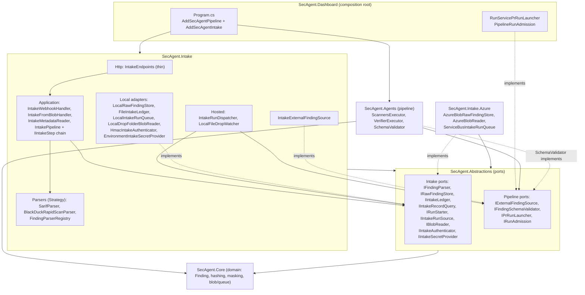

# Design principles

## Intake (SARIF / Black Duck)

The intake (`src/SecAgent.Intake*`, see [intake.md](intake.md)) is built as ports and adapters around a small application core.
Rules it follows:

* **Constructor injection only.** Every service gets its dependencies through its constructor. Everything is registered in one composition
  root, `services.AddSecAgentIntake(configuration)`. Application classes never call `new` on a service, never use a service locator,
  and keep no static state (a reflection test enforces this).
* **Options pattern.** `IOptions<IntakeOptions>` is bound from the `Intake` section and validated on start (`IntakeOptionsValidator`,
  `ValidateOnStart`). Invalid configuration, including an adapter key with no registered implementation, stops the host.
* **Injected time and secrets.** `TimeProvider` drives the HMAC window, claim leases and timestamps. `IIntakeSecretProvider` supplies
  the HMAC secret (env var now, Key Vault later).
* **Dependencies point inwards.** `SecAgent.Abstractions` depends only on the domain model (`SecAgent.Core`). The intake and its Azure
  adapters depend only on the abstractions and the domain model. The pipeline (`SecAgent.Agents`) depends on the abstractions, never on the intake.
  The dashboard wires everything together. A test checks the assembly references.

| Pattern / principle | Where |
|---|---|
| **Ports & adapters** | Ports in `SecAgent.Abstractions/Intake/IntakePorts.cs`: `IRawFindingStore`, `IIntakeLedger`, `IIntakeRecordQuery`, `IRunStarter`, `IIntakeRunSource`, `IBlobReader`, `IIntakeAuthenticator`, `IIntakeSecretProvider`. Local adapters in `SecAgent.Intake/{Storage,Runs,Blob,Security}`, Azure adapters in `SecAgent.Intake.Azure`. Pipeline-facing ports: `IExternalFindingSource`, `IFindingSchemaValidator`, `IPrRunLauncher`, `IRunAdmission`. |
| **Abstract factory by configuration** | Adapters are registered as keyed services (`local`, `azure-blob`, `azure-servicebus`). Each port resolves the key named in `Intake:Adapters:*`. |
| **Strategy** | `IFindingParser` (`SarifParser`, `BlackDuckRapidScanParser`), selected by format through `IFindingParserRegistry`. A new format is one class plus `services.AddIntakeParser<T>()`. Optional `IFileNameFormatHint` lets the Blob path infer the format from a file name. |
| **Adapter** (scanner → canonical) | The parsers turn each scanner format into the canonical `Finding`. They share `FindingNormalisation` (severity, paths) with the built-in gitleaks/Trivy/Semgrep adapters. |
| **Chain of responsibility** | `IntakePipeline` runs ordered `IIntakeStep`s: `PayloadLimitsStep` → `DuplicateFastPathStep` → `ParseStep` → `ClaimStep` → `StoreRawStep` → `CanonicalFindingsStep` → `EnqueueRunStep`. Steps are added with `services.AddIntakeStep<T>()`. |
| **Thin endpoint / application services** | `IntakeEndpoints` only reads the body under the size limit and maps results to HTTP. The use cases live in `IntakeWebhookHandler` (availability → authenticate → metadata → accept), `IntakeFromBlobHandler`, `IntakeMetadataReader` and `IntakePipeline`. None of them depends on ASP.NET. |
| **Interface segregation** | Ledger write side (`IIntakeLedger`) is separate from its read side (`IIntakeRecordQuery`). Run queue producer (`IRunStarter`) is separate from its consumer (`IIntakeRunSource`). The blob event handler (`IBlobIntakeHandler`) is separate from blob reading (`IBlobReader`). |
| **Null object** | `NoExternalFindingSource` covers CLI runs that have no intake. |
| **Hosted services** | `IntakeRunDispatcher` (queue → `IPrRunLauncher`, gated by `IRunAdmission`) and `LocalFileDropWatcher` are `IHostedService`s. Both do nothing when disabled. |
| **Injected cache** (was a static) | `JsonSchemaCache` is a singleton injected into `SchemaValidator`. Each schema has its own registry, so separate instances can coexist. |

What stays static, and why: `ExternalFindingPolicy`, `FindingNormalisation`, `ParserUtil`, `IntakeSignature` and `BlackDuckSarifHints`
are pure functions or constants with no state or I/O, so there is nothing to inject or swap. The existing pipeline (`AgentServices.Create`,
`RunService.AnyActive`, `Hashing.Hmac`) was left as it was. The intake reaches it only through the ports above.

## Evaluation harness (golden set)

`src/SecAgent.Eval` (see [evaluation.md](evaluation.md)) follows the same rules as the intake. It uses constructor injection only, has a
single composition root (`services.AddSecAgentEval(options)`), validates its options on first use, injects `TimeProvider`, and keeps no
mutable static state. Reflection tests enforce the static-state rule, the absence of merge/approve methods, and that services depend on
harness interfaces rather than classes.

| Pattern / principle | Where |
|---|---|
| **Strategy** | `IOutcomeChecker` (one class per check type, looked up by `ICheckerRegistry`), `IEvalFixer` (one per routed fixer id, chosen by `IFixRouter` from `routing.yaml`), `IEvalModelClient` (replay / live / record / stamp), `IGateRule`, `IReportWriter`. Each is added with `AddOutcomeChecker<T>()`, `AddEvalFixer<T>()`, `AddGateRule<T>()` or `AddReportWriter<T>()`. |
| **Keyed services by configuration** | Model clients are keyed by mode. `IEvalModelClient` resolves the key named in `EvalOptions.Mode`. |
| **Decorator** | `RecordingModelClient` wraps the live client and saves its answers. `StampingModelClient` wraps the replay client and writes prompt hashes. |
| **Ports & adapters** | `ICaseSource`, `ICaseWorkspaceFactory`, `IGitDiff`, `IProcessRunner`, `IBuildRunner`, `IFindingScanner`, `ICassetteStore`, `IBaselineStore`, `IPackageVersionResolver` and `ISyntheticSecretGenerator`, each with a file-system or process adapter. The regex scanner can be swapped for a gitleaks/Semgrep/Trivy adapter. |
| **Template method** | `ExpectedValueChecker` (triage decision, fixer, outcome, severity) and `PatternChecker` (absent / present). |
| **Memoised evidence** | `ICaseEvidence` builds, rescans and diffs each workspace at most once, shared by the verifier and all checkers. |
| **Options + validation** | `EvalOptions` and `EvalOptionsValidator` reject an unknown mode, missing folders, a parallelism below 1, or a work root inside the repository. |
| **Pure shared policy** | `TriagePolicy`, `TriageSnippets`, `FixEdits` (in `SecAgent.Agents`) and `ContextAssembler` were extracted from `TriageExecutor`, the fixers and `ContextBuilder`. The pipeline and the harness run the same decision and edit code. |
| **Fakes in tests** | `FakeEvidence` and `FakeBuildRunner` replace `dotnet` in checker and end-to-end tests. Recordings are copied to temp folders and edited to simulate misses, unsafe proposals and regressions. |
