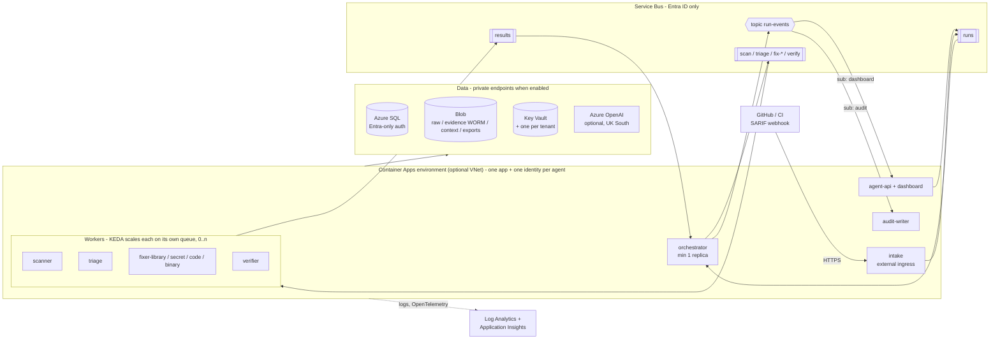

# Azure infrastructure (Bicep)

Status: **validated locally only, never deployed.** No Azure subscription is available to the POC, so
everything under `infra/` has been compiled and linted (`bicep build`, `bicep lint`, `bicep build-params`)
but not run against Azure. Treat the first real deployment as a test: run `what-if` first (the deploy script
always does).

Design reference: System Design Document v0.3 (SDD). Section numbers below point to it.

## In plain language

Today the POC runs as one process on one machine (`secagent serve`). In Azure each agent becomes its own small
service (a *Container App*), and the agents pass work to each other through *queues* (Azure Service Bus), not
in-process calls:

- A webhook endpoint (**intake**) receives SARIF uploads or GitHub events. It saves the raw file to Blob storage
  and puts a short "run requested" message on the `runs` queue.
- The **orchestrator** reads that queue, plans the run, and sends one message per piece of work to the
  `scan`, `triage`, `fix-<type>` and `verify` queues.
- Each worker (**scanner**, **triage**, four **fixers**, **verifier**) only wakes up when its own queue has
  messages, and scales back to zero when the queue is empty. This is done by KEDA, the autoscaler built into
  Container Apps. A spike of library fixes scales only the library fixer.
- Workers reply on the `results` queue. The orchestrator publishes progress once on the `run-events` topic,
  and every interested party gets its own copy: the **dashboard** (agent API) and the **audit writer**.
- State lives in **Azure SQL**, files (raw scanner output, evidence, context packs) in **Blob storage**,
  secrets in **Key Vault**, logs and traces in **Log Analytics / Application Insights**. An **Azure OpenAI**
  account is optional.
- Every app has its **own identity** (a user-assigned managed identity) that can only touch what that app
  needs: for example the triage app can read the `triage` queue and write to `results`, and nothing else on
  Service Bus. No passwords, connection strings or keys are used anywhere: SAS keys on Service Bus, shared keys
  on storage, local auth on Azure OpenAI and SQL logins are all switched **off**.

The same template deploys both business models; only the parameter file changes:

| | Wipro-hosted (model 1) | Customer-hosted (model 2) |
|---|---|---|
| Parameter file | `infra/params/wipro-hosted.bicepparam` | `infra/params/customer-hosted.bicepparam` |
| Subscription | Wipro's | The customer's |
| Tenancy | Multi-tenant: one Key Vault and one set of `raw-`, `evidence-`, `context-` containers per customer tenant | Single tenant: one vault, one set of containers |
| `SECAGENT_PROFILE` passed to the apps | `wipro-hosted` | `customer-hosted` |
| Models | Wipro's Azure OpenAI (UK South) | Customer's own Azure OpenAI (default), or an existing endpoint (`existingModelBaseUrl`) |
| Who deploys | Wipro platform team | Customer's Azure admin, from their copy of the repo |

`infra/params/dev.bicepparam` is the cheap, public-endpoint shape for a first try-out (one synthetic tenant).

## Diagram



## What gets deployed

Naming convention: `<type>-<workload>-<env>-<region>[-<unique>]`, with a 5-character `<unique>` hash (from the
subscription, resource group, workload and environment) only on names that must be globally unique.
Per-app resources are `ca-<app>-<env>` and `id-<app>-<env>`. Storage and registry names have no hyphens.
`<env>` is `dev`, `tst`, `ppd` or `prd`; `<region>` is `uks` for UK South. One resource group per environment
is assumed, for example `rg-secagent-dev-uks`.

Every resource is tagged `workload`, `environment`, `deploymentModel`, `owner`, `costCenter`,
`dataClassification`, `managedBy=bicep`, `designRef=SDD-v0.3` (plus `app` / `tenant` where relevant and any
`extraTags`).

| Resource | Name (dev example) | Module | Purpose / key settings |
|---|---|---|---|
| Log Analytics workspace | `log-secagent-dev-uks` | monitoring | All logs; retention and daily cap are parameters |
| Application Insights | `appi-secagent-dev-uks` | monitoring | Workspace-based; OpenTelemetry target (`APPLICATIONINSIGHTS_CONNECTION_STRING`) |
| Action group | `ag-secagent-dev-uks` | monitoring | Only if `alertEmailReceivers` is set; used by the dead-letter alert |
| VNet, 2 subnets, 2 NSGs, private DNS zones | `vnet-secagent-prd-uks` | network | Only with `enablePrivateNetworking`; `snet-aca` (delegated) and `snet-pe` |
| Private endpoints | `pe-<target>` | privateendpoint | Blob, every Key Vault, SQL, Service Bus (Premium), Azure OpenAI, ACR (Premium) |
| User-assigned identities ×12 | `id-orchestrator-dev`, … | identity | One per app (SDD 13.1) |
| Key Vault (platform) | `kv-secagent-dev-xxxxx` | keyvault | RBAC mode, soft delete, purge protection (param), audit logs; no secrets created |
| Key Vault per tenant | `kv-<tenant>-dev-xxxxx` | keyvault | Wipro-hosted only; connector tokens per customer (SDD 18.1) |
| Service Bus namespace | `sb-secagent-dev-uks-xxxxx` | servicebus | Local (SAS) auth off, TLS 1.2; Standard (dev) or Premium |
| Queues | `runs`, `scan`, `triage`, `fix-library`, `fix-secret`, `fix-code`, `fix-binary`, `verify`, `results` | servicebus | Sessions (SessionId = run id), duplicate detection, max delivery count, lock duration, TTL, dead-letter on expiry |
| Topic + subscriptions | `run-events` → `dashboard`, `audit` (+ `extraTopicSubscriptions`) | servicebus | Pub/sub for run progress |
| Dead-letter alert | `alert-sb-…-deadletter` | servicebus | Fires on any dead-lettered message (needs an action group) |
| Storage account | `stsecagentdevxxxxx` | storage | Shared keys off, no public blobs, TLS 1.2, infrastructure encryption, soft delete |
| Blob containers | `raw[-t]`, `evidence[-t]`, `context[-t]`, `exports` | storage | `evidence*` get a time-based immutability (WORM) policy, created **unlocked** |
| Azure SQL server + database | `sql-secagent-dev-uks-xxxxx` / `sqldb-secagent` | sql | Microsoft Entra-only auth, auditing to Log Analytics, SKU / zone redundancy / backup redundancy are parameters |
| Azure OpenAI (optional) | `oai-secagent-dev-uks-xxxxx` | openai | Local auth off; deployments `small` / `strong` from parameters |
| Container registry | `crsecagentdevxxxxx` | acr | Admin user off; apps pull with AcrPull |
| Container Apps environment | `cae-secagent-dev-uks` | containerapps-env | Workload profiles (Consumption), logs via Azure Monitor (no workspace key), optional VNet / internal / zone redundancy |
| Container Apps ×12 | `ca-intake-dev`, `ca-agent-api-dev`, `ca-orchestrator-dev`, `ca-scanner-dev`, `ca-triage-dev`, `ca-fixer-<type>-dev` ×4, `ca-verifier-dev`, `ca-audit-writer-dev` | containerapp (reusable) | KEDA `azure-servicebus` rule per consumed queue / subscription, authenticated with the app's identity |
| Role assignments | — | rbac | Per app, scoped to the queue / topic / subscription / container / vault (table below) |

### Access per app (least privilege)

| App | Service Bus | Blob | Key Vault | SQL role (grant script) | Azure OpenAI | Ingress |
|---|---|---|---|---|---|---|
| intake | send `runs` | write `raw*` | secrets user (platform + tenants) | — | — | external (IP allow-list param) |
| agent-api | send `runs`; receive sub `dashboard` | read raw/evidence/context; write `exports` | — | inserter | — | internal (param) |
| orchestrator | send `scan`, `triage`, `fix-*`, `verify`, topic `run-events`; receive `runs`, `results` | read raw/evidence/context | secrets user (platform + tenants) | writer | — | none |
| scanner | receive `scan`; send `results` | write `raw*` | secrets user (Black Duck token) | — | — | none |
| triage | receive `triage`; send `results` | read `raw*`; write `context*` | — | inserter | OpenAI User | none |
| fixer-&lt;type&gt; | receive `fix-<type>`; send `results` | read `raw*`; write `context*` | — | inserter | OpenAI User | none |
| verifier | receive `verify`; send `results` | read `raw*`; write `evidence*` | — | inserter | OpenAI User | none |
| audit-writer | receive sub `audit` | write `evidence*` | — | inserter | — | none |

Every app also gets AcrPull on the registry. Azure SQL access is not Azure RBAC: `main.bicep` outputs a T-SQL
script (`sqlGrantScript`) that creates a contained database user per identity (from its client id, so the SQL
server needs no directory-read permission) and adds it to `secagent_reader`, `secagent_inserter` or
`secagent_writer`. Those three roles are schema-wide; narrowing them to table-level grants is an open item.

### Settings passed to every app (no secret values)

`AZURE_CLIENT_ID` (so `DefaultAzureCredential` picks the app's identity), `OTEL_SERVICE_NAME`,
`SECAGENT_PROFILE`, `SECAGENT_ENVIRONMENT`, `SECAGENT_AGENT`, `SECAGENT_QUEUE=servicebus`,
`SECAGENT_SERVICEBUS_NAMESPACE`, `SECAGENT_RUN_EVENTS_TOPIC`, `SECAGENT_BLOB_ENDPOINT`, `SECAGENT_KEYVAULT_URI`,
`APPLICATIONINSIGHTS_CONNECTION_STRING`; plus `SECAGENT_SQL` (passwordless connection string,
`Authentication=Active Directory Managed Identity`) for apps with a SQL role, and `SECAGENT_MODEL_PROVIDER`,
`SECAGENT_MODEL_BASE_URL`, `SECAGENT_SMALL_MODEL`, `SECAGENT_STRONG_MODEL` for model apps when a model endpoint
is configured. Secrets (for example `SECAGENT_HMAC_KEY`) are added as **Key Vault references** with the
`appKeyVaultReferences` parameter once the secret exists in the vault.

> The POC code today reads `SECAGENT_SQL`, `SECAGENT_HMAC_KEY` and the `SECAGENT_MODEL_*` variables. The other
> names are a proposed contract for the Service Bus / Blob / Key Vault adapters that the code does not have yet.

## Files

```
infra/
  main.bicep                 composes everything for one environment (resource-group scope)
  rg.bicep                   optional: creates the resource group (subscription scope)
  bicepconfig.json           linter rules (CI fails on any error)
  validate.sh                build + lint + build-params for every file (used locally and in CI)
  deploy.sh                  what-if, confirm, deploy, save outputs + SQL grant script (documented, not run)
  params/
    dev.bicepparam           cheap public-endpoint dev shape
    wipro-hosted.bicepparam  model 1, prod shape, multi-tenant
    customer-hosted.bicepparam  model 2, prod shape, single tenant
  modules/
    network.bicep  privateendpoint.bicep  monitoring.bicep  identity.bicep  rbac.bicep
    keyvault.bicep  servicebus.bicep  sql.bicep  storage.bicep  acr.bicep  openai.bicep
    containerapps-env.bicep  containerapp.bicep (reusable, KEDA azure-servicebus scaler)
.github/workflows/infra-validate.yml   runs infra/validate.sh on PRs touching infra/ (no Azure login)
```

## Validate locally (no Azure needed)

```bash
# Option A: Azure CLI
az bicep install && infra/validate.sh
# Option B: standalone Bicep CLI (https://github.com/Azure/bicep/releases)
USE_STANDALONE_BICEP=1 infra/validate.sh
```

`validate.sh` fails on any error and on any linter warning except `use-recent-api-versions` (that one only
appears as API versions age, so it is reported but does not break the build).

## How to deploy

Prerequisites for both models: Azure CLI with Bicep, `az login` as someone with the roles listed under
"What to ask the Azure team", and two Microsoft Entra groups: SQL admins and Key Vault operators.

```bash
export SECAGENT_SQL_ADMIN_OBJECT_ID=<object id of the SQL admin group>
export SECAGENT_SQL_ADMIN_LOGIN=<display name of that group>
export SECAGENT_KV_OPERATORS_GROUP_ID=<object id of the Key Vault operators group>   # optional
```

### Model 1: Wipro-hosted

1. Copy `params/wipro-hosted.bicepparam` per environment (`test`, `preprod`, `prod`) and set the tenant codes,
   VNet ranges, sizes and `[to confirm]` values.
2. Preview, then deploy:
   ```bash
   infra/deploy.sh -p wipro-hosted -g rg-secagent-prd-uks --what-if-only   # look first
   infra/deploy.sh -p wipro-hosted -g rg-secagent-prd-uks                  # what-if again, confirm, deploy
   ```
   Add `--create-rg` only if you have rights to create resource groups in the subscription.
3. Onboarding a new customer tenant = add its code to `tenants` and redeploy. This creates its vault and
   containers and grants the shared apps access to them.

### Model 2: Customer-hosted

1. The customer imports the repo into their own source control and edits `params/customer-hosted.bicepparam`
   (VNet ranges from their IP plan, hub DNS servers, customer tag, model choice).
2. The customer's admin runs, in the customer subscription:
   ```bash
   az account set --subscription <customer subscription>
   infra/deploy.sh -p customer-hosted -g rg-secagent-prd-uks --what-if-only
   infra/deploy.sh -p customer-hosted -g rg-secagent-prd-uks
   ```
3. Nothing in the deployment points back to Wipro: images are built into the customer's own registry and the
   models are the customer's own.

### After the first deployment (both models)

`deploy.sh` prints these steps with the real names filled in:

1. **Database:** as a member of the SQL admin group, from a network that can reach the server, run
   `db/schema.sql`, the migrations in `db/migrations/`, then the generated `infra/out/<deployment>.sql-grants.sql`
   (`sqlcmd -G`).
2. **Secrets:** a member of the Key Vault operators group sets secret values (HMAC key, GitHub App key, webhook
   signing secret, Black Duck / Jira tokens per tenant). Then list them per app in `appKeyVaultReferences`, for
   example `{ orchestrator: [ { envName: 'SECAGENT_HMAC_KEY', secretName: 'secagent-hmac-key' } ] }`, and
   redeploy. A Container App fails to start if a referenced secret does not exist yet, which is why this is a
   second step.
3. **Images:** the first deployment uses a public placeholder image (`usePlaceholderImages = true`) because the
   registry is empty. Push `secagent-<app>` images, set `usePlaceholderImages = false` (better: `imageOverrides`
   with digests) and redeploy.
4. **Webhook:** point the SARIF / GitHub webhook at the `intakeUrl` output and fill `intakeAllowedSourceRanges`
   (for GitHub, the `hooks` ranges from `https://api.github.com/meta`).
5. **Evidence lock:** the evidence immutability policy is created unlocked so mistakes can be fixed. Locking
   it is irreversible and is a separate, deliberate operator step once the retention period is agreed.

## Cost drivers (no prices)

No prices are given here on purpose: use the Azure pricing calculator for UK South with the agreed sizes. What
moves the bill, roughly in order of likely impact:

- **Azure OpenAI tokens.** Billed per input / output token and per model; the strong tier costs more per token
  than the small tier. Driven by findings per run, retries and context size. Prompt caching (stable prefix,
  SDD 12) reduces input cost. Provisioned throughput (PTU) is a different, fixed-capacity pricing model.
- **Service Bus Premium.** A fixed charge per messaging unit per hour, whether busy or idle. Standard is charged
  per operation with a small base charge. Premium is needed for private endpoints.
- **Container Apps.** Charged for vCPU-seconds and memory-seconds while replicas run (plus requests). Workers
  scale to zero, so cost follows workload; anything with `minReplicas >= 1` (intake, agent API, orchestrator in
  prod) is billed continuously. The heavy apps (scanner, fixers, verifier: 2 vCPU / 4 GiB by default) dominate
  during runs. Zone redundancy needs at least one replica per zone in practice.
- **Azure SQL.** Provisioned vCores bill per hour; serverless bills for compute used and pauses when idle (dev).
  Zone redundancy and geo / zone backup redundancy add to it; storage is billed separately.
- **Log Analytics / Application Insights.** Billed by GB ingested and by retention beyond the included period.
  Verbose traces and diagnostic logs (Service Bus, SQL audit, storage) can grow quickly; `logDailyQuotaGb` caps it.
- **Private networking.** Each private endpoint has an hourly charge plus data processed; each private DNS zone
  has a monthly charge. The Wipro-hosted model has one Key Vault private endpoint per tenant.
- **Storage.** Capacity (evidence under WORM cannot be deleted until retention ends, so it accumulates),
  transactions, and redundancy (ZRS costs more than LRS).
- **Container registry.** Daily charge by SKU; Premium (needed for private endpoint) costs more.
- **Key Vault.** Per operation; small unless secrets are read on every request (cache them).
- **Not in this template but likely:** egress firewall / NAT gateway, Front Door / WAF in front of the intake,
  APIM (SDD AI gateway), Microsoft Defender for Cloud plans, bandwidth out of Azure.

## What to ask the Azure team

**Subscription and resource groups**
- A subscription (or confirmation of the existing one) for each environment, and resource groups named
  `rg-secagent-<env>-uks` (or their naming standard: we will align names and tags to it).
- These resource providers registered: `Microsoft.App`, `Microsoft.ServiceBus`, `Microsoft.Sql`,
  `Microsoft.Storage`, `Microsoft.KeyVault`, `Microsoft.ManagedIdentity`, `Microsoft.OperationalInsights`,
  `Microsoft.Insights`, `Microsoft.Network`, `Microsoft.CognitiveServices`, `Microsoft.ContainerRegistry`.
- The Azure Policy assignments that apply (allowed regions, required tags, "deny public network access",
  DNS zone placement), so the parameters can match them before the first what-if.

**Roles for whoever (or whatever pipeline) deploys**
- `Contributor` on the resource group, **and** `Role Based Access Control Administrator` (or
  `User Access Administrator`) on the resource group, because the template creates role assignments for the
  app identities. If they want to constrain it, the template only assigns: Azure Service Bus Data Sender,
  Azure Service Bus Data Receiver, Storage Blob Data Reader, Storage Blob Data Contributor, Key Vault Secrets
  User, Key Vault Secrets Officer (operators group), Cognitive Services OpenAI User, AcrPull.
- Subscription-level rights only if we should create the resource group ourselves (`--create-rg`).
- For CI/CD later: an app registration / managed identity with a GitHub OIDC federated credential (no client
  secret), with the same two roles.
- Two Microsoft Entra groups (and their object ids): **SQL admins** (Entra admin of the server) and **Key Vault
  operators** (set secret values).

**Quota and capacity in UK South**
- Azure OpenAI: which models and versions are available in UK South for regional **Standard** deployments
  (keeps processing in region), and tokens-per-minute quota for a small and a strong model. Whether Global /
  Data Zone deployments are acceptable for data residency (they may process outside the UK).
- Container Apps: vCPU quota for the environment in UK South (the heavy apps use 2 vCPU each when scaled out).
- Azure SQL vCore quota and confirmation that zone redundancy is available for the chosen SKU.
- Service Bus Premium messaging units, if Premium is agreed.

**Networking**
- A non-overlapping address space: at least a /23 for Container Apps and a /24 for private endpoints
  (defaults `10.40.0.0/16` and `10.50.0.0/16` are placeholders).
- Hub-and-spoke: VNet peering, and whether private DNS zones must live centrally in the hub (then we stop
  creating them here and link to theirs) and which DNS servers to use.
- Egress allow-list through their firewall: GitHub (`github.com`, `api.github.com`, `*.githubusercontent.com`),
  the Black Duck host, Jira, `mcr.microsoft.com` (placeholder / base images), Microsoft Entra ID
  (`login.microsoftonline.com`), Azure Monitor ingestion endpoints.
- Inbound for the intake webhook: is a public endpoint with an IP allow-list (GitHub hook ranges) and
  signature check acceptable, or must it sit behind Front Door / Application Gateway with WAF
  (then set `internalEnvironment = true`)?
- How operators reach private endpoints to set secrets and run the SQL scripts (VPN, Bastion / jump host).
- Whether a central Log Analytics workspace must be used instead of a per-environment one.

## Assumptions and open items

- **Not deployed.** Validated with Bicep CLI 0.47.16 (`build`, `lint`, `build-params`). No `what-if` has been
  run, so ARM-side checks (quota, policy, name availability, API-version support in UK South) are untested.
- **Queue names** use hyphens (`fix-library`); the SDD draws them as `fix.library`. Both are valid in Service
  Bus; the code adapter must use the same names.
- **Intake is a Container App** with external ingress (as requested for the SARIF webhook). The SDD shows the
  GitHub intake and timers as Function Apps; `backlog-timer`, `notifier` and `dlq-handler` are **not** in this
  template yet.
- **Not included yet** (in the SDD module outline): APIM AI gateway (SDD: the only path to Azure OpenAI in the
  target; here apps get the OpenAI User role directly), App Configuration (rules labels, kill switch flag),
  Azure Functions, egress firewall, Front Door / WAF, Defender for Cloud, budgets.
- **KEDA scaler permissions:** each app's identity has *Azure Service Bus Data Receiver* on the queue or
  subscription it consumes, and the scale rule uses that identity. Some reports say the scaler needs more
  (namespace scope or Data Owner) to read message counts; confirm on the first deployment and widen only if
  needed. Also confirm the scaler and Key Vault references work through private endpoints in a VNet-integrated
  environment.
- **Sessions:** every queue requires sessions (SessionId = run id). Decision OD-03 may make `triage`
  sessionless (`sessionlessQueues` parameter). Values marked `[to agree]` in SDD 7.4 (max delivery count, TTL,
  lock duration, duplicate window) are parameters with the POC defaults.
- **Code changes needed before real images run:** Service Bus / Blob / Key Vault adapters behind the existing
  interfaces (`IMessageQueue`, blob store), and managed-identity (token) auth for the `azureopenai` provider,
  which today expects an API key in `ApiKeyEnv`. Local auth on Azure OpenAI is disabled here.
- **SQL grants** are schema-wide roles; narrow to per-table grants once the target schema settles. The grant
  script has not been run against Azure SQL (it uses `CREATE USER … WITH SID … TYPE = E`, which is Azure-only).
- **Multi-tenant isolation** in this template covers per-tenant vaults and containers. Row-level security in
  SQL (`tenant_id`), database-per-tenant (OD-16) and per-tenant identities are not here.
- **Model deployments** in the parameter files (`gpt-4.1-mini`, `gpt-4.1`, version `2025-04-14`, 10k TPM) are
  illustrative placeholders: confirm models, versions and quota for UK South.
- **Agent API / dashboard** is internal by default because the POC dashboard has no login. Exposing it needs an
  auth layer (Container Apps authentication with Entra ID, or APIM) and the IP allow-list parameter.
- **Application Insights connection string** is passed as a plain environment variable (Microsoft does not
  treat it as a secret). Switching to Entra-authenticated ingestion is an option.
- **Key Vault names** are globally unique and soft-deleted vaults keep their name for the retention period;
  redeploying a deleted environment may need a purge (impossible with purge protection on) or a new name.
