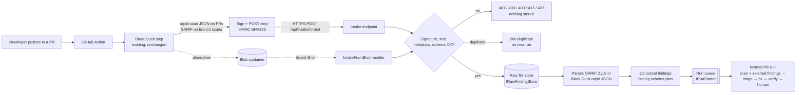

# SARIF / Black Duck intake

The agent can take scanner results **pushed** to it from a CI pipeline. The first producer is Black Duck running in GitHub
Actions; any tool that writes SARIF 2.1.0 works the same way. Nothing polls the Black Duck API: if the workflow does not push,
the agent does nothing.

> All samples, tests and fixtures in this repo are **synthetic** (CVE-2099-*, BDSA-2099-*, `synthetic-org/*`). No customer data.

## In plain words

1. A developer opens or updates a pull request.
2. The repo's GitHub Action runs Black Duck as it does today.
3. One extra step signs the result file with a shared secret and POSTs it to the agent (or uploads it to a Blob container).
4. The agent checks the signature, size and format, keeps the raw file, turns it into the same finding records the built-in
   scanners produce, and starts a normal PR run (triage → fix → verify → human review). A retried workflow does not start a second run.



## Endpoint

`POST /api/intake/{format}` where `format` is `sarif` or `blackduck-rapid`. Body = the raw file (`Content-Type: application/json`
or `application/sarif+json`). Metadata travels in headers, **all of them covered by the signature**:

| Header | Required | Example | Notes |
|---|---|---|---|
| `X-SecAgent-Repo` | yes | `my-org/orders-api` | `owner/name`; can be restricted with `Intake:AllowedRepos` |
| `X-SecAgent-Pr` | PR scans | `42` | omit (or empty) for branch / nightly scans → **backlog mode** |
| `X-SecAgent-Ref` | no | `feature/x` | head branch |
| `X-SecAgent-Head-Sha` | yes | 40 (or 64) hex chars | the commit that was scanned |
| `X-SecAgent-Scanner` | yes | `blackduck` | must be in `Intake:AllowedScanners` and the finding schema's `source_scanner` enum |
| `X-SecAgent-Run-Id` | yes | `9876543210-1` | `${{ github.run_id }}-${{ github.run_attempt }}` |
| `X-SecAgent-Timestamp` | yes | `1790000000` | unix seconds, must be within ±300 s of server time |
| `X-SecAgent-Signature-256` | yes | `sha256=<hex>` | see below |

**Signature (scheme `secagent-intake-v1`).** `hex(HMAC-SHA256(secret, canonical))` where `canonical` is these lines joined by `\n`:

```
secagent-intake-v1
<timestamp>
<format>                 # URL segment, lower case
<repo>
<pr>                     # "" when absent
<ref>                    # "" when absent
<head sha>
<scanner>
<run id>
<sha256 hex of the body>
```

Signing the metadata (not just the body, as GitHub webhooks do) means a captured upload cannot be replayed against another repo,
PR or commit. Comparison is constant-time. Reference implementations: `IntakeSignature.Sign` (C#, `SecAgent.Abstractions`) and the bash/python step in
`.github/workflows/examples/blackduck-push.yml`, which the test suite runs against a live test server.

**Idempotency key** = sha256(repo | head sha | scanner | run id | format). The PR number is deliberately not part of it (the same
commit scanned by the same workflow run is the same evidence).

| Response | Meaning |
|---|---|
| `202 accepted` | stored, parsed, run queued. Body: `intake_id`, `idempotency_key`, `mode`, `findings`, `by_issue_type`, `raw`, `run_ticket`, `notes` |
| `200 duplicate` | same key and same body already accepted (workflow retry); nothing new happens |
| `409` | same key, **different** body: send a new run id. Also (`status: failed`) when the key used up `Intake:MaxClaimTakeovers` |
| `503 in_progress` | same key and body, but another delivery is still processing it (inside `Intake:ClaimLeaseSeconds`), or this delivery's claim was taken over while it was running. Sent with `Retry-After`; retry (curl `--retry` honours it). Never reported as `duplicate`, because that delivery may still fail |
| `400` | missing/invalid metadata, body not JSON |
| `401` | missing/bad signature, wrong secret, timestamp outside the window, any signed header changed |
| `403` | repo not in `Intake:AllowedRepos` |
| `404` | unknown format |
| `413` | body over `Intake:MaxBodyBytes` (Content-Length checked first, then the stream is cut off) or more than `MaxResults` results |
| `422` | wrong structure (e.g. SARIF version other than 2.1.0, no `runs`), or parsed findings fail `rules/schema/finding.schema.json` |
| `503` | intake disabled, or the secret env var is not set (the endpoint never runs unauthenticated) |

**Claims and retries.** The first delivery claims the idempotency key. If it fails after that (rejected, storage or queue error,
cancelled), the claim is marked `failed` and the next retry takes it over at once. If it crashes or stalls without marking anything, the
claim is taken over once it is older than `Intake:ClaimLeaseSeconds` (120 s). A takeover is a compare-and-set on the record's claim token
that also issues a new token, so only one of several concurrent retries resumes it. Only an accepted intake (a run was requested) answers
`200 duplicate`.

A claim is a **lease, not a lock**: a delivery that was merely slow (longer than the lease) can still be running when a retry takes
its claim over. So every write the claim holder makes is **fenced** with its claim token: `IIntakeLedger.TryUpdate(record,
expectedClaimToken)` is a compare-and-set (in `FileIntakeLedger` under the same lock as claim creation and takeover; an ETag / rowversion
check in a cloud ledger) that returns `Updated`, `LostOwnership` or `NotFound`. The port has no unconditional update. The pipeline renews
the claim with that write before every step after the claim (which also extends the lease), and the canonical-findings, queued, release
(`failed`) and dispatcher (`run_started`, `superseded`, `start_failed`, `backlog_pending`) writes all go through it. A delivery that gets
`LostOwnership` stops at once with no further side effects (nothing more stored, no enqueue, no ledger write) and answers `503 in_progress`
with `Retry-After`; the producer's retry then sees the new owner's result. The fence is checked before each side effect, not held across
it: a delivery that stalls between the check and the write can still do that one write, which the write-once raw store and the queue's
MessageId dedupe absorb.

Takeovers are capped per key by `Intake:MaxClaimTakeovers` (default 5, counted on the record). When a further takeover would exceed it,
the record is marked `failed` for good (`terminal: true`, with the reason in `detail`) under a token nobody holds, and the delivery gets
`409` (send a new run id), instead of a payload that keeps crashing the worker being reclaimed forever.

`GET /api/intake` lists the last 100 intakes (metadata, counts, status; never payload content). It is **authenticated** like the POST:

* `Authorization: Bearer <token>`, where the token is in the env var named by `Intake:AdminTokenEnv` (default `SECAGENT_INTAKE_ADMIN_TOKEN`; in Azure, a Key Vault reference). This is for operators and tools.
* A request signed with the intake HMAC secret: the same `secagent-intake-v1` signature and timestamp window, with `_list` in place of the
  format, no metadata headers and an empty body (`IntakeSignature.Sign(secret, "_list", {}, ts, [])`). Turn it off with
  `Intake:ListingAcceptsHmac=false`. Holders of the secret can already push findings, so reading the metadata adds no privilege.
* Dev only: `Intake:ListingAllowsLoopback=true` lets a caller on the same machine list without credentials, only if the request
  carries no proxy headers (`Forwarded`, `X-Forwarded-For`, …). It is off by default; never enable it behind a tunnel or reverse proxy.

With none of these configured the listing answers 503. With some configured but no valid credential presented, it answers 401.

## What happens to the findings

* **Raw file**: stored write-once at `intake/<repo>/<sha>/<scanner>-<run id>.<format>.json` through `IRawFindingStore`
  (local: `.data/blob/raw/…`; Azure: the same path in a Blob container). Secret snippets are removed before storage.
* **Canonical findings**: the same `Finding` record and JSON schema the built-in gitleaks/Trivy/Semgrep adapters produce
  (severity mapping reuses `FindingNormalisation.Severity`, shared with the built-in adapters), stored next to the raw file as `.canonical.json`, each tagged `attributes.intake_id`.
* **Run**: `IRunStarter` enqueues a message on the queue `runs` (`RunQueueConvention`; the same name locally and in Service Bus, and
  the queue `infra/agents.bicep` creates). Message id = idempotency key (Service Bus duplicate detection uses it); session id = the run
  target (`owner/repo#<pr>`, or `owner/repo@<ref>`), so the session-enabled Bicep queue works as created and one PR's requests are
  handed out in order. If an environment lists `runs` in the Bicep `sessionlessQueues`, set `Intake__Azure__RunQueueRequiresSession=false`.
  The dispatcher waits until no run is active and the kill switch is off, then starts the
  same PR run `POST /api/runs` starts. During that run the scanner stage adds the pushed findings for that exact repo + head SHA to its
  own scanner output (`IExternalFindingSource`), so they flow through triage, fixing and human review like any other finding.
* **Verification limit (by design)**: the local re-scan cannot confirm a Black Duck finding is gone, so a fix for an external finding
  is never auto-verified; it is marked "needs re-scan by that scanner" and goes to a human. The next Black Duck run on the fix PR
  closes the loop.
* **Head SHA check**: the run is started for the queued head SHA only. `RunService` compares it with the PR head on the same snapshot
  the run uses. If the PR moved on before the dispatcher got to it, nothing starts and the intake is marked `superseded`, with the old and
  new SHA in `detail`: its findings would not apply to the new head, and the producer's scan of the new head brings fresh ones.
* **Backlog mode** (no PR number, e.g. nightly on main): stored, parsed and recorded as `backlog_pending`. Slice 1 has no backlog
  runner yet; the data is ready for one.

## Field mapping

### SARIF 2.1.0 (any tool)

One SARIF `result` = one finding. Results with `kind` pass/notApplicable, `baselineState` absent, or a producer suppression (status accepted or none) are skipped and counted in `notes`.

| Canonical | From |
|---|---|
| `rule_id` | `result.ruleId` / `rule.id` (via `ruleIndex` / `rule` reference) |
| `title` | `rule.shortDescription` → `result.message.text` |
| `severity_scanner` / `severity` | `properties.severity` / `security-severity` (CVSS → band) / `result.level` / `rule.defaultConfiguration.level` |
| `file_path`, `line_start`, `line_end` | first `locations[].physicalLocation` (`artifactLocation.uri` made repo-relative; `region`). `originalUriBaseIds` are not resolved yet |
| `cve_ids`, `cwe_ids` | properties (`cve`, `cwe`, …), tags `external/cwe/cwe-79`, any `CVE-…` / `BDSA-…` id in rule id, tags, description |
| `component_name`, `component_version`, `purl`, `fixed_version` | properties (`componentName`, `componentVersion`, `purl`, `fixedVersion`, …) |
| `licence_id` | properties (`licenseId`, `spdxId`, …) |
| `issue_type` | secret-like rule → `secret`; component/CVE → `vulnerable_dependency`; licence → `licence`; else `code` |
| `fingerprint` | `partialFingerprints` / `fingerprints`, else hash of rule + location + component |
| secrets | `secret_hash` = HMAC of the snippet; the snippet itself is never stored |

**Black Duck SARIF hints** (`BlackDuckSarifHints`, applied only to SCA-shaped rules). ASSUMPTIONS from public sample reports, not a
documented contract: component and version from the rule id / "`<name version>` has the following vulnerabilities" description;
severity from the `:red_circle:` / `:orange_circle:` / `:yellow_circle:` markers (critical / high / medium); short- and long-term
upgrade versions from the table in `help.markdown`; `direct:` / `transitive:` prefixes.

### Black Duck rapid-scan JSON

Built from public sources (Detect's `RapidModeGenerateJsonOperation`, which writes
`<project>_<version>_BlackDuck_DeveloperMode_Result.json` as a top-level array of `DeveloperScansScanView`; the `{ "items": [...] }`
API shape and Detect's `componentList` location file are accepted too). All property names live in **one record,
`BlackDuckRapidFieldMap`**, each with fallbacks: that is the only place to edit when a real sample differs.

| Canonical | From (first present) |
|---|---|
| one `vulnerable_dependency` finding per component | `policyViolationVulnerabilities[]` aggregated: `cve_ids` = all `name`s (CVE + BDSA), severity = highest `vulnSeverity`, `cwe_ids` = union of `cweIds` |
| one `licence` finding per violating licence | `policyViolationLicenses[]` (`name`, `licenseFamilyName`); severity from the policy severity (BLOCKER → critical, CRITICAL → high, MAJOR → medium, MINOR → low; ASSUMPTION) |
| `component_name` / `component_version` | `componentName` / `versionName` |
| `purl` | `packageUrl` (only with extended data; name ASSUMED), else built from `componentIdentifier` / `externalId` |
| `fixed_version` | `shortTermUpgradeGuidance.versionName`, long-term kept in attributes |
| direct vs transitive | `transitiveUpgradeGuidance` present / `dependencyTrees` length (ASSUMPTION) |
| `file_path` | `filePath` (ASSUMPTION: the manifest; may be the scan root) or `declarationLocation` in the location file |

Rapid scans only report components that **violate a policy**. Components that violate a policy without a vulnerability or licence
(e.g. "unknown version") are noted in `notes` but not mapped to findings.

**Black Duck SARIF and PRs.** Per the public Bridge CLI docs, SARIF report generation is not supported in a PR context. So PR workflows
should push the rapid-scan JSON (keep it with `--detect.cleanup=false`), and SARIF is used for full branch scans such as the nightly job.

## Configuration

`src/SecAgent.Dashboard/appsettings.json`, section `Intake` (override in `appsettings.Local.json`):

| Key | Default | |
|---|---|---|
| `Enabled` | `true` | env `SECAGENT_INTAKE_ENABLED=0` turns it off, for the webhook **and** the Blob path (`503`; the drop folder leaves files in place) |
| `ClaimLeaseSeconds` | `120` | an unfinished claim older than this is taken over by the next delivery; before that, retries get `503 in_progress` |
| `MaxClaimTakeovers` | `5` | lifetime ceiling on claim takeovers per key (1..100); past it the key is failed for good (`409`) |
| `AdminTokenEnv` | `SECAGENT_INTAKE_ADMIN_TOKEN` | **name** of the env var holding the bearer token for `GET /api/intake` |
| `ListingAcceptsHmac` | `true` | `GET /api/intake` also accepts an HMAC-signed request (scope `_list`) |
| `ListingAllowsLoopback` | `false` | dev only: unauthenticated listing from this machine without proxy headers |
| `HmacSecretEnv` | `SECAGENT_INTAKE_HMAC_SECRET` | **name** of the env var holding the secret; the secret is never in a file |
| `TimestampToleranceSeconds` | `300` | replay window |
| `MaxBodyBytes` | `26214400` (25 MB) | |
| `MaxResults` | `20000` | results/components per file |
| `AllowedScanners` | `["blackduck"]` | |
| `AllowedRepos` | `[]` (any) | e.g. `["my-org/*"]` |
| `DropWatcherEnabled` / `DropFolder` | `false` / `.data/intake/drop` | dev Blob stand-in; env `SECAGENT_INTAKE_DROP_WATCHER=1` |
| `StorageRoot` | set by the host (`.data`) | root of the local adapters: `RawStoreRoot` (`blob`), `LedgerFolder` (`intake/ledger`), `DropFolder` |
| `DispatcherEnabled` | `true` | run the queue → pipeline dispatcher in this process |
| `DefaultBlobFormat` | `sarif` | for dropped blobs without `format` metadata that no parser recognises by name |
| `Adapters:RawStore` / `Ledger` / `RunQueue` / `BlobReader` | `local` | `azure-blob` (RawStore, BlobReader) / `azure-servicebus` (RunQueue) after `AddSecAgentIntakeAzure`; see "Swapping in Azure services" |

Options are bound with the Options pattern and **validated on start** (bad ranges, missing storage root, or an adapter key with no
registered implementation stop the host with a clear message). Any key can also come from an env var (`Intake__MaxBodyBytes=…`).

Secret: generate once (`openssl rand -hex 32`), put it in the GitHub secret `INTAKE_HMAC_SECRET` and in the agent's environment
(`~/.secagent/secagent.env` locally). In Azure App Service use a Key Vault reference:
`SECAGENT_INTAKE_HMAC_SECRET=@Microsoft.KeyVault(SecretUri=https://<vault>.vault.azure.net/secrets/intake-hmac/)`. Rotation: set the
new value in both places; requests signed with the old one get 401 until the workflow uses the new secret.

The dashboard prints `Intake: POST /api/intake/{sarif|blackduck-rapid} enabled` (or `refusing (set …)`) at start-up.

**Reachability.** The dashboard binds to `127.0.0.1`. GitHub-hosted runners cannot reach that, so for a trial either use a
self-hosted runner on the same network, a tunnel (e.g. `cloudflared` / dev tunnels) that forwards only `/api/intake/*`, or host the
dashboard (App Service + private endpoint / IP allow-list for GitHub's runner ranges). The HMAC check is what protects the endpoint,
but only `/api/intake/*` should be exposed: the rest of the dashboard has no authentication in this POC.

## Wiring your real workflow

1. Copy `.github/workflows/examples/blackduck-push.yml` into the application repo's `.github/workflows/` (files in `examples/` are
   ignored by GitHub, so nothing runs here).
2. Replace the placeholder with your **existing** Black Duck step. Make sure it runs a rapid scan on PRs and leaves the result file
   (`--detect.cleanup=false`, or Bridge diagnostics). Adjust the search roots in "Locate the Black Duck result" if needed.
3. Add the repo (or org) secrets `INTAKE_URL` (base URL, no path) and `INTAKE_HMAC_SECRET`.
4. Optional: copy `blackduck-nightly-main.yml` for the nightly full SARIF scan of `main` (backlog mode).
5. Open a test PR. The step log prints the agent's response; the dashboard shows the run, and `GET /api/intake` the intake record.

The sign-and-POST step uses only `bash`, `sha256sum`, `python3` and `curl` (all on GitHub-hosted Ubuntu runners), reads every input
from `env:` (no `${{ }}` inside the script), and treats 200 (duplicate) as success so re-runs are harmless.

### Alternative: Blob upload + Event Grid

Commented out in the example workflow: `azure/login` with GitHub OIDC (no stored secret), then `az storage blob upload` with the
metadata as blob metadata (`repo`, `pr`, `ref`, `head_sha`, `scanner`, `run_id`, `format`). A `BlobCreated` Event Grid subscription
calls `IntakeFromBlobHandler`, which reads the blob (`IBlobReader`, managed identity) and goes through the same validation, dedupe,
parse and enqueue path. There is no HMAC on this path: trust comes from RBAC on the container (only the workflow's federated identity
can write). **TODO** for the Azure version: Event Grid webhook validation handshake (or an Azure Function / Service Bus subscription
in front). The blob reader itself exists: `AzureBlobReader` in `SecAgent.Intake.Azure`.

Local dev stand-in: set `SECAGENT_INTAKE_DROP_WATCHER=1`, then drop `x.sarif.json` plus `x.sarif.json.meta.json`
(`{"format":"sarif","repo":"synthetic-org/sample-orders","pr":7,"ref":"feature/x","head_sha":"<40 hex>","scanner":"blackduck","run_id":"local-1"}`)
into `.data/intake/drop/`. Processed files move to `processed/`, rejected ones to `rejected/` with a `.result.json` explaining why.
Retryable answers (`503`: intake disabled, or the same payload in progress) leave both files where they are for the next scan.

### Option: GitHub OIDC instead of a shared secret (TODO)

The workflow requests an id-token (`permissions: id-token: write`, audience = the intake URL) and sends it as a bearer token. A second
`IIntakeAuthenticator` validates it against `https://token.actions.githubusercontent.com/.well-known/jwks`, checks `iss`, `aud`, and that
the `repository`, `sha` and `run_id` claims match the signed headers (plus an allow-list of `repository_owner` / workflow refs). No
shared secret to rotate. Not implemented in this slice; the interface is ready.

## Swapping in Azure services

Every port has a local adapter; the Azure ones live in `src/SecAgent.Intake.Azure` (Entra ID auth via `DefaultAzureCredential`, no keys)
and are chosen by configuration, with no code change in the intake:

```csharp
builder.Services.AddSecAgentIntake(builder.Configuration);
builder.Services.AddSecAgentIntakeAzure(builder.Configuration);   // registers the "azure-*" adapters
// appsettings: "Intake": { "Adapters": { "RawStore": "azure-blob", "BlobReader": "azure-blob", "RunQueue": "azure-servicebus" },
//                          "Azure": { "BlobServiceUri": "https://<acct>.blob.core.windows.net", "ServiceBusNamespace": "<ns>.servicebus.windows.net" } }
```

| Port (SecAgent.Abstractions) | Local adapter (`local`) | Azure adapter |
|---|---|---|
| `IRawFindingStore` | `LocalRawFindingStore` over the write-once local blob store | `AzureBlobRawFindingStore` (create-only uploads, same `blob://raw/…` URIs) |
| `IIntakeLedger` + `IIntakeRecordQuery` | `FileIntakeLedger` (atomic create-new claim files; claim-token compare-and-set under one lock, single instance) | TODO: SQL table with a unique key + rowversion, or Table Storage with ETag (If-Match) for `TryUpdate` |
| `IRunStarter` + `IIntakeRunSource` | `LocalIntakeRunQueue` (in-process queue, message id = key) | `ServiceBusIntakeRunQueue` (duplicate detection on `MessageId`) |
| `IBlobReader` | `LocalDropFolderBlobReader` (drop folder only) | `AzureBlobReader` (managed identity) |
| `IIntakeAuthenticator` | `HmacIntakeAuthenticator` | same; OIDC option is a TODO |
| `IIntakeSecretProvider` | `EnvironmentIntakeSecretProvider` (env var; Key Vault reference in App Service) | same, or a `SecretClient` provider |

The Azure adapters compile and are wired by tests, but have not been run against a live subscription. Design notes: [design-principles.md](design-principles.md).

## What to ask the Black Duck admin for

1. **A real sample of each file** from a PR run and from a full/nightly run: the rapid-scan JSON
   (`*_BlackDuck_DeveloperMode_Result.json`) and the SARIF report. Sanitised is fine; we only need the structure. These replace the
   assumptions above (`BlackDuckRapidFieldMap`, `BlackDuckSarifHints`).
2. Detect / Bridge CLI / GitHub Action **versions** in use, and the exact step YAML.
3. Whether `blackducksca_reports_sarif_groupSCAIssues` is on (one SARIF rule per component vs per vulnerability).
4. Whether `BLACKDUCK_RAPID_SCAN_EXTENDED_DATA` (or equivalent) can be enabled: it adds purl / SPDX ids.
5. The **policies** applied to rapid scans (rapid scans only report policy violations, so policies decide what we ever see), and their severities.
6. The project / version naming convention, and whether scans run per repo or per service in a monorepo.
7. Where the workflow runs (GitHub-hosted or self-hosted runners) and which network path to the agent is allowed (decides webhook vs Blob).

## Tests

`tests/SecAgent.Tests/IntakeTests.cs` and `IntakeHttpTests.cs`, fixtures in `tests/SecAgent.Tests/Fixtures/intake/` (synthetic):
parser mapping for SARIF and rapid JSON, secret redaction, HMAC (valid, wrong secret, stale, tampered header/body), dedupe and
conflict, oversize / invalid / unknown-format rejection, external findings in the scanner and verifier stages, dispatcher, drop
folder, and an end-to-end test over real HTTP (Kestrel on a random port) into a fake run starter, including running the example
workflows' own sign-and-POST bash against it.
